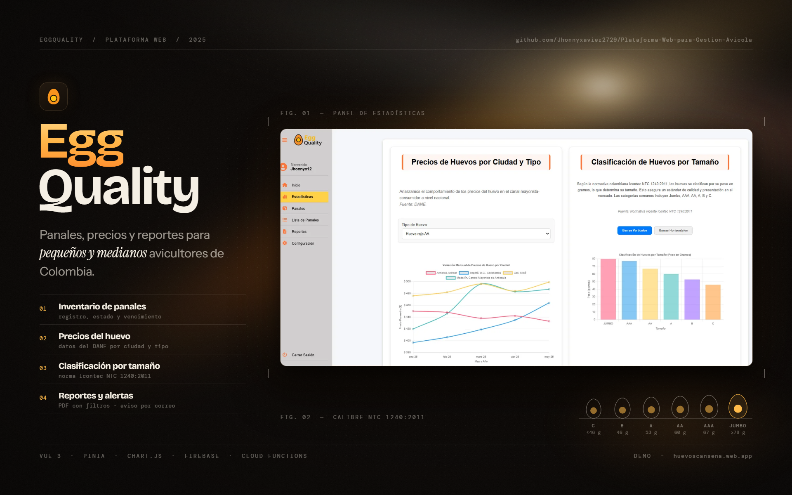

# 🥚 EggQualite: Sistema Web de Gestión y Análisis de Huevos



## ¡Bienvenido a EggQualite! 🚀

EggQualitë es una aplicación web diseñada para revolucionar la gestión integral de panales de huevos y el análisis del comportamiento de precios del huevo en el mercado mayorista-consumidor a nivel nacional en Colombia. Nuestro objetivo es proporcionar a pequeños y medianos avicultores una herramienta robusta e intuitiva para digitalizar sus procesos de control de inventario y optimizar la toma de decisiones, reemplazando métodos manuales por una plataforma eficiente e intuitiva.

### ¿Para quién es EggQualite?
Este sistema está pensado para pequeños y medianos avicultores en Colombia, incluyendo propietarios de granjas, gerentes de producción y personal administrativo encargado del inventario y la comercialización. Se espera que los usuarios tengan un nivel básico a intermedio de alfabetización digital y estén familiarizados con el uso de navegadores web y aplicaciones en línea.

## Características Principales 📋

EggQualitë ofrece una serie de funcionalidades clave para la gestión avícola:

* **Autenticación Segura de Usuarios:** Permite el registro, inicio y cierre de sesión, así como la recuperación de contraseña.
* **Visión General de Producción (Dashboard):** Un resumen ejecutivo del estado actual de tus panales (activos, vencidos, vendidos, totales) para una gestión rápida.
* **Análisis Interactivo de Precios de Mercado:** Visualiza estadísticas históricas de precios de huevos por tipo y ciudad en las principales plazas de mercado de Colombia. Fuente: Departamento Administrativo Nacional de Estadística –DANE-. Información pública.
* **Clasificación Oficial por Tamaño:** Consulta la clasificación oficial de huevos por tamaño según la normativa colombiana Icontec NTC 1240:2011.
* **Gestión Detallada de Panales:** Funcionalidades completas para el registro, consulta, edición y eliminación lógica de tus panales de huevos.
* **Generación de Reportes Personalizados:** Crea y descarga informes de panales en formato PDF con filtros por estado, tipo de huevo y rango de fechas.
* **Notificaciones Automatizadas de Vencimiento:** Recibe alertas por correo electrónico sobre la proximidad del vencimiento de tus panales.
* **Personalización de Usuario:** Configura tus preferencias de notificación y gestiona tu cuenta personal.

## Tecnologías Utilizadas 🛠️

EggQualitë está construido sobre una arquitectura moderna y robusta:

* **Frontend:** Aplicación web responsiva diseñada para navegadores modernos en cualquier dispositivo, utilizando las siguientes tecnologías:
    * **Vue.js:** Un framework progresivo para construir interfaces de usuario.
    * **JavaScript:** El lenguaje de programación principal para la interactividad web.
    * **CSS:** Para el diseño y la estilización de la interfaz de usuario.
* **Backend:** Construido sobre la infraestructura de Google **Firebase**.
    * **Firebase Authentication:** Para la gestión segura de usuarios.
    * **Firestore:** Base de datos NoSQL para el almacenamiento de datos en la nube.
    * **Cloud Functions:** Entorno de ejecución sin servidor para la lógica de negocio del backend y procesos automatizados (ej. notificaciones de vencimiento).

---

🥚 EggQualitë - Gestor de Calidad para Avicultura
EggQualitë es una aplicación web diseñada para la gestión y análisis de datos en la producción avícola. Permite a los avicultores llevar un registro detallado de sus panales de huevos, analizar la calidad, y generar reportes para optimizar su operación.

📌 Nota Importante: La versión actualmente desplegada es una demostración pública. Su propósito es permitir la observación y testeo de las funcionalidades principales. Para obtener acceso a la versión completa y productiva, por favor póngase en contacto con nosotros. contáctanos en: [eggquality3@gmail.com](mailto:eggquality3@gmail.com) 

🚀 Demo en Vivo
Puedes probar la aplicación de demostración aquí:

👉 Acceder a la Demo de EggQualitë 👈

 **Accede a la Aplicación:** Abre tu navegador web favorito (Chrome, Firefox, Edge, Safari) y visita la siguiente URL:
    Visita mi [ Acceder a la Demo de EggQualite ](https://huevoscansena.web.app/).

4.  **Si deseas obtener el acceso completo de la web escribanos al correo electronico para gestionar consultas, contáctanos en: [eggquality3@gmail.com](mailto:eggquality3@gmail.com)


---

## ⚙️ Para Desarrolladores: Instalación y Configuración Local

Si eres un desarrollador y deseas clonar este repositorio, contribuir al código o desplegar tu propia instancia de EggQualitë, sigue estas instrucciones:

### Prerrequisitos

Asegúrate de tener instalado lo siguiente:

* **Node.js y npm:** Necesarios para ejecutar el proyecto JavaScript/TypeScript.
* **Git:** Para clonar el repositorio.
* **Una cuenta de Google Cloud / Firebase:** Deberás configurar un proyecto de Firebase.
* **Firebase CLI:** Para desplegar las Cloud Functions y gestionar tu proyecto de Firebase desde la terminal. Instálalo con:
    ```bash
    npm install -g firebase-tools
    ```

### Pasos de Instalación

1.  **Clona el Repositorio:**
    ```bash
    git clone [https://github.com/tu-usuario/EggQualite.git](https://github.com/tu-usuario/EggQualite.git)
    cd EggQualite
    ```
    *(Reemplaza `https://github.com/tu-usuario/EggQualite.git` con la URL real de tu repositorio.)*

2.  **Configura tu Proyecto Firebase:**
    * Ve a la [Consola de Firebase](https://console.firebase.google.com/) y crea un nuevo proyecto.
    * Habilita los siguientes servicios en tu proyecto de Firebase:
        * **Firebase Authentication** (Métodos de inicio de sesión: Email/Contraseña).
        * **Firestore Database** (Comienza en modo de producción o de prueba, y establece las reglas de seguridad adecuadas).
        * **Cloud Functions** y **Cloud Scheduler** (para las funciones programadas de notificaciones y actualización de estado).

3.  **Descarga la Clave de Cuenta de Servicio para el Admin SDK (¡Solo para desarrollo local/scripts!):**
    * Ve a la [Consola de Firebase](https://console.firebase.google.com/).
    * Navega a **Configuración del proyecto** ⚙️ > **Cuentas de servicio**.
    * Haz clic en "Generar nueva clave privada". Esto descargará un archivo JSON (ej. `your-project-name-firebase-adminsdk-xxxxx-xxxxxx.json`).
    * **Renómbralo** a `serviceAccountKey.json` y colócalo en la carpeta `backend/`.
    * **¡MUY IMPORTANTE:** Asegúrate de que `backend/serviceAccountKey.json` esté en tu `.gitignore` para NO subirlo al repositorio público!

4.  **Importa los Datos Iniciales de `eggPrices`:**
    * Este proyecto incluye un conjunto de datos iniciales para la colección `eggPrices` (datos históricos de precios) en el archivo `data/eggPrices.json`.
    * Para cargar estos datos en tu base de datos Firestore, ejecuta el siguiente script desde la raíz del proyecto:
        ```bash
        node backend/seed_data.js # Asegúrate que la ruta al script sea correcta
        ```
        * **Nota:** Este script asume que tienes el archivo `serviceAccountKey.json` configurado como se indica en el paso anterior.

5.  **Configura SendGrid (para Notificaciones por Correo Electrónico):**
    EggQualitë utiliza SendGrid para enviar notificaciones de vencimiento de panales. Deberás configurar tu cuenta de SendGrid y sus credenciales en Firebase Secret Manager para que las Cloud Functions puedan utilizarlas de forma segura.

    a.  **Crea una cuenta en SendGrid:** Regístrate en [SendGrid](https://sendgrid.com/).
    b.  **Crea una API Key en SendGrid:**
        * En tu panel de SendGrid, navega a **Settings** > **API Keys**.
        * Crea una nueva API Key con permisos para el envío de correo (mínimo: **Mail Send**).
        * **Copia la API Key generada de inmediato**, ya que solo se mostrará una vez.
    c.  **Configura el Sender Identity en SendGrid:**
        * Ve a **Settings** > **Sender Authentication**.
        * Verifica la dirección de correo electrónico que usarás como remitente de las notificaciones (ej. `notificaciones@tudominio.com`). **Copia esta dirección verificada.**
    d.  **Crea una Plantilla Dinámica en SendGrid (opcional pero recomendado):**
        * Si tu función `sendExpirationAlerts` utiliza una plantilla dinámica, créala en **Email API** > **Dynamic Templates**.
        * Diseña tu plantilla usando las variables de sustitución esperadas por tu función (ej. `{{nombreUsuario}}`, `{{diasRestantes}}`, `{{panales}}`).
        * **Copia el Template ID** (ej. `d-XXXXXXXXXXXXXX`).
    e.  **Guarda las credenciales de SendGrid en Firebase Secret Manager:**
        Desde la terminal, dentro de la carpeta `backend` (o donde estén tus Cloud Functions), ejecuta los siguientes comandos. Reemplaza los valores con tu API Key, el correo remitente y el ID de tu plantilla.

        ```bash
        firebase functions:secrets:set SENDGRID_API_KEY
        # Pega tu API Key de SendGrid cuando te lo solicite y presiona Enter

        firebase functions:secrets:set SENDGRID_SENDER_EMAIL
        # Pega tu correo electrónico verificado de SendGrid y presiona Enter

        firebase functions:secrets:set SENDGRID_EXPIRATION_TEMPLATE_ID
        # Pega el ID de tu plantilla dinámica de SendGrid y presiona Enter
        ```
        Para verificar que los secretos se han establecido correctamente:
        ```bash
        firebase functions:secrets:access SENDGRID_API_KEY --json
        firebase functions:secrets:access SENDGRID_SENDER_EMAIL --json
        firebase functions:secrets:access SENDGRID_EXPIRATION_TEMPLATE_ID --json
        ```

6.  **Configura el Frontend:**
    ```bash
    cd frontend # O el nombre de tu carpeta frontend
    npm install
    ```
    * Crea un archivo `.env.local` en la raíz de tu carpeta `frontend` y añade tus claves de configuración de Firebase (las encontrarás en la configuración de tu proyecto Firebase -> Configuración del proyecto -> Tus apps -> Añadir app -> Web). **Asegúrate de que las variables comiencen con `VITE_APP_` si usas Vite, o `VUE_APP_` si usas Vue CLI.** Por ejemplo:
        ```env
        VITE_APP_FIREBASE_API_KEY="AIza..."
        VITE_APP_FIREBASE_AUTH_DOMAIN="tu-proyecto.firebaseapp.com"
        VITE_APP_FIREBASE_PROJECT_ID="tu-proyecto"
        VITE_APP_FIREBASE_STORAGE_BUCKET="tu-proyecto.appspot.com"
        VITE_APP_FIREBASE_MESSAGING_SENDER_ID="..."
        VITE_APP_FIREBASE_APP_ID="1:..."
        VITE_APP_FIREBASE_MEASUREMENT_ID="G-..."
        ```
    * Además, recuerda añadir `/.env.local` y `.env` a tu `.gitignore` en la raíz de la carpeta `frontend` para evitar subirlos al repositorio.

7.  **Configura el Backend (Cloud Functions):**
    ```bash
    cd backend # O el nombre de tu carpeta de funciones
    npm install
    firebase login # Inicia sesión con tu cuenta de Google
    firebase use --add # Selecciona el proyecto Firebase que creaste
    ```
    * Asegúrate de que tu `index.js` en las funciones está configurado para usar `defineSecret` como lo tienes en tu código para acceder a los secretos de SendGrid.

8.  **Despliega las Cloud Functions (¡con los secretos!):**
    Para que las funciones puedan acceder a los secretos de SendGrid y las variables de entorno, deberás desplegarlas.

    ```bash
    firebase deploy --only functions
    ```
    Cuando despliegas funciones que usan `defineSecret`, Firebase automáticamente asegura que los secretos estén disponibles para esas funciones.

9.  **Ejecuta el Frontend Localmente (para desarrollo):**
    ```bash
    cd ../frontend # Si estabas en la carpeta backend
    npm install # Asegúrate de que todas las dependencias del frontend estén instaladas
    npm run dev # O npm start, dependiendo de tu script de inicio en package.json de Vue.js
    ```
    Esto debería abrir la aplicación en tu navegador en `http://localhost:5173` (si usas Vite) o `http://localhost:8080` (si usas Vue CLI).

10. **Despliega la Aplicación a Firebase Hosting (para producción/acceso público):**
    Una vez que la aplicación esté lista para ser pública, puedes desplegar tu frontend a Firebase Hosting.
    ```bash
    cd frontend # Si estabas en la carpeta backend
    npm run build # Genera los archivos estáticos de tu aplicación Vue.js
    firebase deploy --only hosting
    ```
    Firebase te proporcionará una URL pública donde tu aplicación estará disponible.

## Uso de la Aplicación 🚀

Una vez que la aplicación esté corriendo (localmente o desplegada), podrás:

1.  **Registrarte** como nuevo usuario.
2.  **Iniciar sesión** con tus credenciales.
3.  Explorar el **Inicio** para ver el resumen de tus panales.
4.  Navegar al módulo de **Estadísticas** para analizar precios y la clasificación de huevos.
5.  Gestionar tus **Panales** (registrar, ver, editar, eliminar lógicamente).
6.  Generar y descargar **Reportes** personalizados.
7.  Configurar tus **Preferencias de Notificación** y actualizar tu perfil.

## Contribución 🤝

¡Agradecemos cualquier contribución para mejorar EggQualitë! Si deseas colaborar, por favor:

1.  Haz un "fork" de este repositorio.
2.  Crea una nueva rama (`git checkout -b feature/nueva-funcionalidad`).
3.  Realiza tus cambios y commitea (`git commit -m 'feat: Añade nueva funcionalidad X'`).
4.  Sube tus cambios (`git push origin feature/nueva-funcionalidad`).
5.  Abre un Pull Request.

## Autores 🧑‍💻👩‍💻

* **Jhonny Ramirez** [@jhonnyxavier2729](https://github.com/jhonnyxavier2729)
* **Adriana Guazaquillo** [@Adrianag99](https://github.com/Adrianag99)

## Soporte o Dudas 🧑‍💻👩‍💻
Para consultas, contáctanos en: [eggquality3@gmail.com](mailto:eggquality3@gmail.com)
